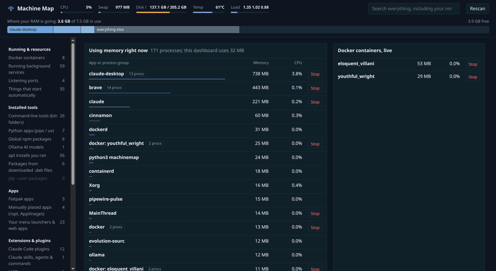
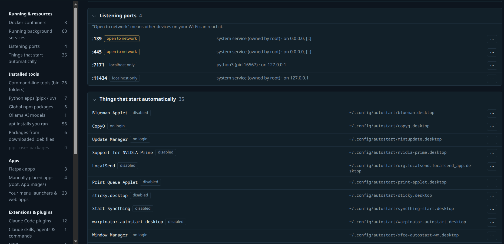
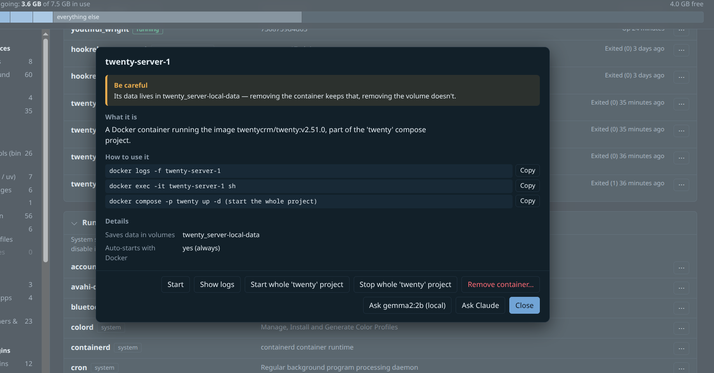

# Machine Map

One page that shows everything installed and running on your Linux machine: Docker containers, services, open ports, CLI tools, pip/pipx/uv/npm packages, apt installs, Flatpaks, Snaps, AppImages, editor and browser extensions, Claude Code plugins and MCP servers, git repos, Ollama models, and what is eating your RAM right now.

It's for the moment you think "I installed something for this last month… what was it, and how do I run it?", and for laptops where every 200 MB counts.



- **Dashboard and command line.** The same inventory, explanations and actions in your browser or your terminal.
- **One file, no dependencies.** Python 3.9+ standard library only. No pip install, no Node, no Electron.
- **Light.** The server idles at about 30 MB of RAM and quits on its own 3 minutes after you close the tab.
- **Explains before it acts.** Every item has a "What is this?" panel: what it does, how to use it (from `tldr` or its own help), how you installed it (matched from your shell history), and whether removing it is safe, risky or system-critical.
- **Acts with the tool's own commands.** Start/stop/remove containers, update or uninstall packages with `apt`, `pipx`, `uv`, `npm`, `flatpak`, `snap`, `cargo`, `code --install-extension`, `claude plugin`… Removals show a dry run first, and most come with an Undo.

## Install

```bash
git clone https://github.com/Harshyadav812/MachineMap.git
cd MachineMap
./install.sh
```

Then open **Machine Map** from your app menu, or run `machinemap`. To remove it: `./install.sh --uninstall`.

Or just run it without installing:

```bash
python3 machinemap.py
```

## Use

| Command | What it does |
| --- | --- |
| `machinemap` | Opens the dashboard in your browser |
| `machinemap --no-open` | Starts the server without opening a browser |
| `MACHINEMAP_PORT=8080 machinemap` | Uses another port (default 7171) |

### In the terminal

Everything the dashboard does also works as a command, without opening a browser:

```bash
machinemap list                    # every section with its count
machinemap list docker ports       # what's in those sections
machinemap search scraper          # names, paths, tags and your notes
machinemap info ollama             # what it is, how to use it, is it safe to remove
machinemap top --watch 2           # live RAM and CPU by app, like a friendlier htop
machinemap do twenty-server-1      # list its actions…
machinemap do twenty-server-1 Stop # …and run one, by name or number
machinemap ask lsd --with local    # explain it with your local Ollama model
machinemap note copyq "clipboard history, keep it"
machinemap updates                 # available updates (apt, flatpak, npm)
machinemap cleanup                 # caches that are safe to clear, with sizes
machinemap removed                 # what you removed, and how to get it back
```

- **Section names:** `docker`, `ports`, `services`, `startup`, `bin`, `pipx`, `npm`, `apt`, `flatpak`, `apps`, `extensions`, `claude`, `mcp`, `ollama`, `repos` or `history`.
- **When a name matches several items,** it asks which one; add `--in SECTION` to narrow it down.
- **`do`** shows the same risk warning, dry run and undo as the dashboard, then asks before running. `--yes` skips the question, except for system-critical items. Admin actions ask for your password in the terminal.
- **For scripts:** `list`, `search`, `info` and `top` take `--json`. Plain output is one item per line when piped, so `grep` works.
- **Colors:** set `NO_COLOR=1` to turn them off.

In the page:





- Click any name to see what it is, how to use it, and what removing it would do.
- Click ⋯ on a row for its actions and to add a note ("used for the scraper project, safe to remove after March"). Notes are searchable.
- Press `/` to search everything, including your notes.
- **Ask &lt;AI&gt;** buttons explain an item in plain words. You get one button per AI you have set up (see below); with none, MachineMap works the same, just without them.

## Choosing an AI (optional)

MachineMap finds these on its own:

- **Ollama**: your smallest downloaded model, free and offline. It's loaded into RAM only while it answers and unloaded the moment it's done or you close the window.
- **The `claude` CLI**, if it's installed. It uses your Claude plan.
- **`ANTHROPIC_API_KEY`**, if it's set in the environment MachineMap starts from.

To use anything else, create `~/.config/machinemap/ai.json`. Every entry becomes an **Ask &lt;name&gt;** button:

```json
{
  "providers": [
    {"name": "GPT", "type": "openai", "model": "gpt-4o-mini", "key_env": "OPENAI_API_KEY"},
    {"name": "OpenRouter", "type": "openai", "url": "https://openrouter.ai/api/v1",
     "model": "meta-llama/llama-3.3-70b-instruct", "key_env": "OPENROUTER_API_KEY"},
    {"name": "LM Studio", "type": "openai", "url": "http://localhost:1234/v1", "model": "qwen2.5-7b-instruct"},
    {"name": "Claude API", "type": "anthropic", "model": "claude-haiku-5-5", "key": "sk-ant-..."},
    {"name": "Gemini", "type": "command", "command": ["gemini", "-p", "{prompt}"]},
    {"name": "llm", "type": "command", "command": ["llm", "-m", "gpt-4o-mini"]}
  ],
  "auto_detect": true,
  "ollama": {"model": "llama3.2:3b"}
}
```

| Type | Works with | Fields |
| --- | --- | --- |
| `openai` | Any OpenAI-compatible chat API: OpenAI, OpenRouter, Groq, Mistral, DeepSeek, Together, and local servers like LM Studio, llama.cpp, vLLM or a remote Ollama (`http://host:11434/v1`) | `model`, `url` (default `https://api.openai.com/v1`), key |
| `anthropic` | Anthropic's Messages API | `model`, `url` (optional), key |
| `command` | Any command-line tool | `command` as a list of arguments. `{prompt}` is replaced by the question; without it, the question goes to the tool's standard input |

- **API keys:** put the variable's name in `key_env` (defaults: `OPENAI_API_KEY` / `ANTHROPIC_API_KEY`), or write the key itself in `key`. Apps started from the menu don't see variables set in `~/.bashrc`, so `key` is often simpler; the file is yours to protect with `chmod 600`. Local servers need no key.
- **`"auto_detect": false`** hides the detected `claude` CLI and `ANTHROPIC_API_KEY`.
- **`"ollama": false`** hides the Ollama button; `{"model": "..."}` picks a model instead of the smallest.

Each button's tooltip says where the question goes. Cloud providers receive the facts MachineMap gathered about that one item: its name, path, description and how you installed it. Keys stay on the server and never reach the page. Answers are saved in `~/.config/machinemap/explanations.json`, so asking again is instant and free.

## What it reads

Everything is read locally from `/proc`, `/sys`, `dpkg`, `apt`, `systemctl`, `ss`, `docker`, package-manager folders, `~/.bash_history` / `~/.zsh_history` / fish history, and git checkouts up to 4 levels under your home folder. Nothing is sent anywhere unless you press an **Ask** button for a cloud AI.

Your notes, the log of things you removed, and saved explanations live in `~/.config/machinemap/` (readable only by you).

## Security

- **Only you can open it.** The server listens on `127.0.0.1` only, but other accounts on the machine (and containers using host networking) can reach that too. So the page opens only through the link the launcher makes: it carries a secret kept in a file only you can read (`$XDG_RUNTIME_DIR/machinemap-7171.token`), which your browser then keeps as a cookie. Every API request needs that secret as well.
- **Websites can't use it.** Requests carrying another site's `Host`, `Origin` or `Sec-Fetch-Site` are refused, and the page can't be framed by other sites.
- **It never runs your programs on its own.** Usage notes come from `tldr`, man pages or a script's own comments. A program's `--help` runs only when you press the button for it, since a program may ignore `--help` and just run.
- **Secrets stay hidden.** Passwords, tokens and API keys in your shell history, process command lines and MCP configs are shown as `•••`. They're masked again in anything sent to an AI.
- **AI answers can't take actions.** Facts sent to an AI are marked as data to describe, never instructions, and the built-in Claude CLI provider runs with tools turned off. If you add your own `command` provider, use one with tools disabled too, because READMEs from repos you cloned end up in the prompt.
- **The page only sends ids.** It never sends a command line, only the id of an action the server built itself. Admin actions go through `pkexec`, so your desktop asks for your password each time.

Found a problem? Please open an issue.

## Platform

Built and tested on Linux Mint 22 (Cinnamon). It should work on Ubuntu, Debian and their derivatives. On other distributions the apt sections are simply empty, and everything else still works.

## License

MIT
